<h1 align="center">
  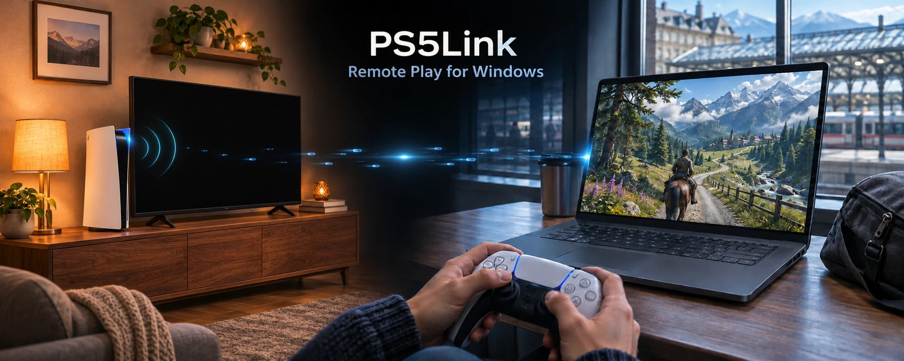
</h1>

<strong>PlayStation Remote Play for Windows · Удалённая игра на PlayStation с Windows</strong>

  
  
  

<a href="#english">English</a> · <a href="#русский">Русский</a>

## English

PS5Link streams a PS5 or PS4 to a Windows PC. In the Avalonia launcher,
**Connect** starts the stream, and collapsible sections give you quick access
to video, network, controller and appearance settings.

### Install and connect

1. Download the [Windows x64 installer](https://github.com/Q1W1RTY/PS5Link/releases/latest).
   Setup installs for the current user and adds a Start menu shortcut.
2. Enable Remote Play on your PlayStation. In PS5Link, open
   **Advanced settings → Consoles → Register New** and enter the pairing
   code shown on the console. For connections outside your local network,
   sign in to PlayStation Network under **Remote**.
3. Close the settings window and press **Connect**. PS5Link selects the
   console marked for auto-connect or the only registered console. If a
   manual choice is needed, it opens the console list.

### Video and controls

- **Video.** Direct3D 12, hardware decoding, HDR on compatible hardware,
  shader scaling, AMD FSR 1.0 and built-in frame interpolation.
- **In-game controls.** Press **Ctrl+O** to open the overlay for video
  settings, volume, microphone and the performance HUD.
- **DualSense and network.** Adaptive triggers, haptics, lightbar,
  packet buffer presets and keyframe requests for video recovery.

Requires Windows 10 version 2004 or later, or Windows 11, on x64. The
installer is unsigned. RTX VSR, DLSS and AMD FSR 3.1 frame generation
require separate compatible modules. The **Without RTX** preset works with
the bundled components. The **RU / EN** button changes the launcher language
immediately and the client language on its next launch.

In the installed launcher, click **Update** next to the version number to
check GitHub Releases. PS5Link verifies the download, installs the update
in the current app folder and reopens the launcher.

## Русский

PS5Link передаёт изображение и звук с PS5 или PS4 на компьютер Windows.
В лаунчере на Avalonia кнопка **«Подключиться»** запускает трансляцию,
а настройки видео, сети, геймпада и внешнего вида собраны в сворачиваемые
разделы.

### Установка и подключение

1. Скачайте [установщик для Windows x64](https://github.com/Q1W1RTY/PS5Link/releases/latest).
   Он устанавливает приложение для текущего пользователя и добавляет
   ярлык в меню «Пуск».
2. Включите дистанционное воспроизведение на PlayStation. В PS5Link
   откройте **«Дополнительно» → «Консоли» → «Зарегистрировать новую»**
   и введите код привязки с экрана PlayStation. Для подключения вне
   локальной сети войдите в PlayStation Network во вкладке **«Сеть»**.
3. Закройте настройки и нажмите **«Подключиться»**. PS5Link выберет консоль,
   отмеченную для автоподключения, или единственную зарегистрированную.
   Если нужен ручной выбор, откроется список.

### Видео и управление

- **Видео.** Direct3D 12, аппаратное декодирование, HDR на совместимом
  оборудовании, шейдерное масштабирование, AMD FSR 1.0 и встроенная
  интерполяция кадров.
- **Меню в игре.** Нажмите **Ctrl+O**, чтобы открыть настройки видео,
  громкости и микрофона или включить HUD производительности.
- **DualSense и сеть.** Адаптивные триггеры, вибрация, подсветка,
  пресеты буфера пакетов и запрос ключевого кадра для восстановления видео.

Требуется Windows 10 версии 2004 или новее либо Windows 11, x64.
Установщик без цифровой подписи. Для RTX VSR, DLSS и генерации кадров
AMD FSR 3.1 нужны отдельные совместимые модули. Пресет **«Без RTX»**
работает с библиотеками из установщика. Кнопка **RU / EN** меняет язык
лаунчера сразу, а язык клиента при следующем запуске.

В установленном лаунчере нажмите **«Обновить»** рядом с номером версии.
PS5Link проверит релизы GitHub, проверит скачанный установщик, обновит
приложение в той же папке и снова откроет лаунчер.

## Screenshots / Скриншоты

### Gameplay / Кадры из игры

<table>
  <tr>
    <td align="center" width="50%"><a href="docs/ps5link/screenshots/game-overlook.webp">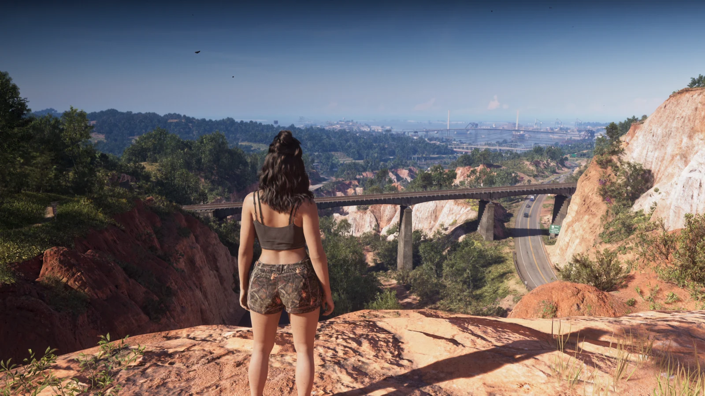</a> View from the hills / Вид с холмов</td>
    <td align="center" width="50%"><a href="docs/ps5link/screenshots/game-hud.webp">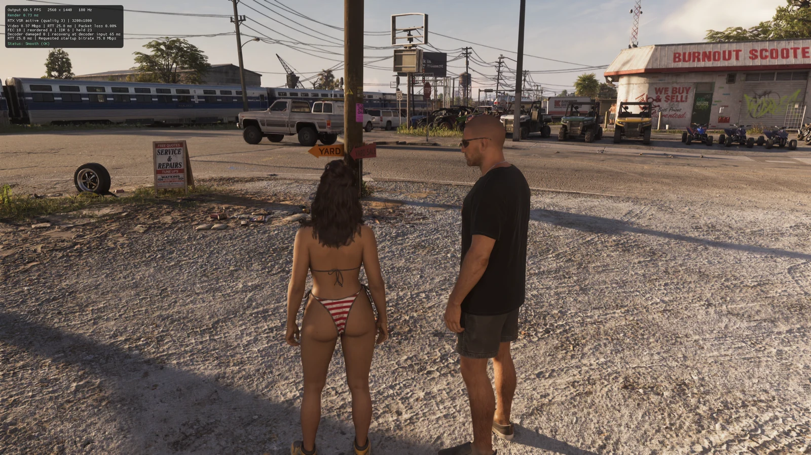</a> Performance HUD / HUD производительности</td>
  </tr>
  <tr>
    <td align="center"><a href="docs/ps5link/screenshots/game-avenue.webp">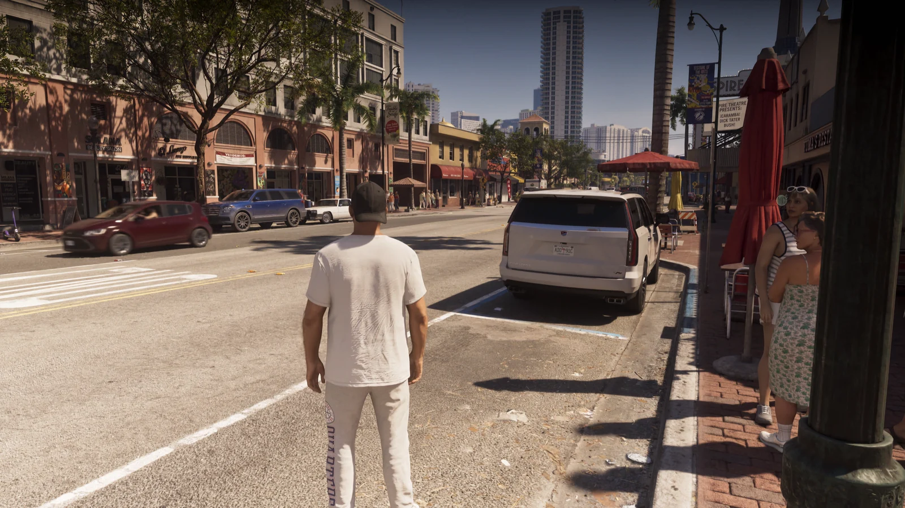</a> City avenue / Городской проспект</td>
    <td align="center"><a href="docs/ps5link/screenshots/game-mural.webp">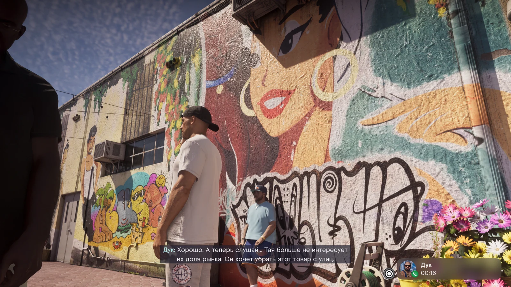</a> Street art / Городское граффити</td>
  </tr>
  <tr>
    <td align="center"><a href="docs/ps5link/screenshots/game-rooftop.webp">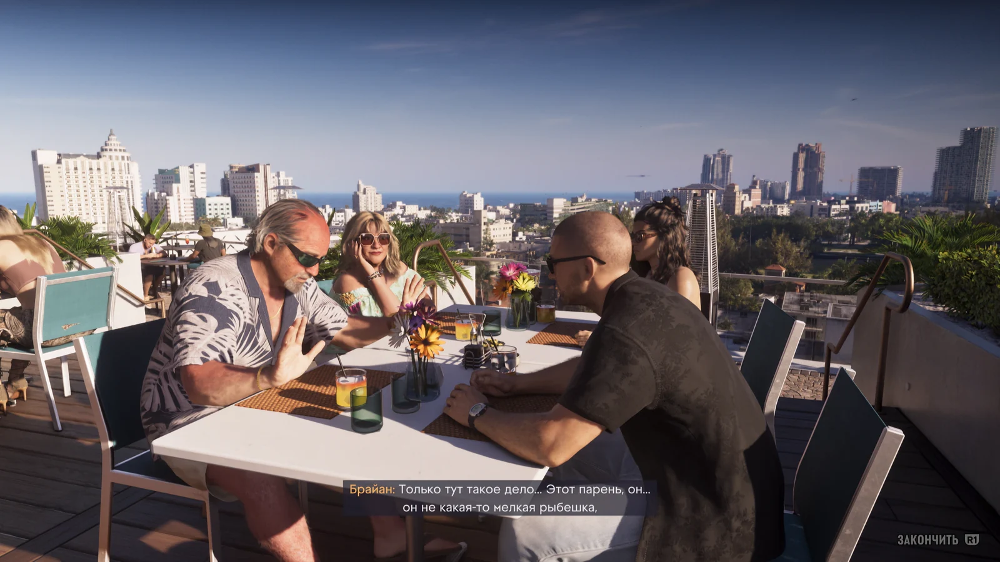</a> Rooftop scene / Сцена на крыше</td>
    <td align="center"><a href="docs/ps5link/screenshots/game-street.webp">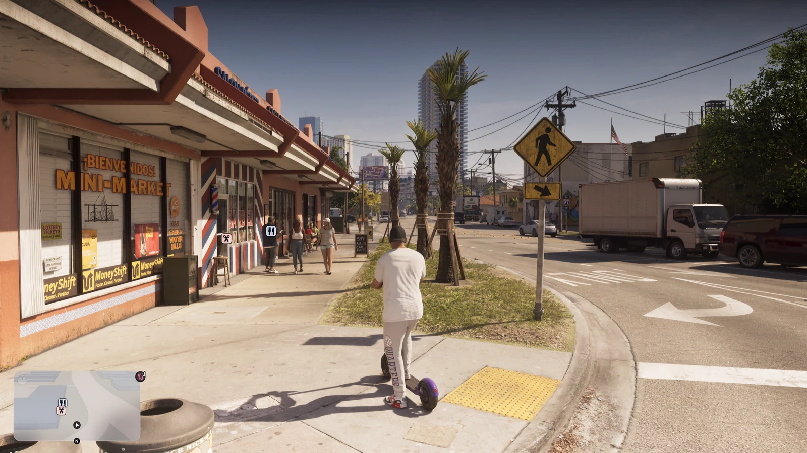</a> Neighborhood walk / Прогулка по району</td>
  </tr>
</table>

### Launcher, settings and setup / Лаунчер, настройки и установка

<table>
  <tr>
    <td align="center" width="50%"><a href="docs/ps5link/launcher.png">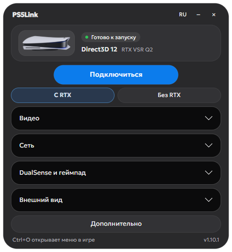</a> Launcher / Лаунчер</td>
    <td align="center" width="50%"><a href="docs/ps5link/screenshots/settings-compact.webp">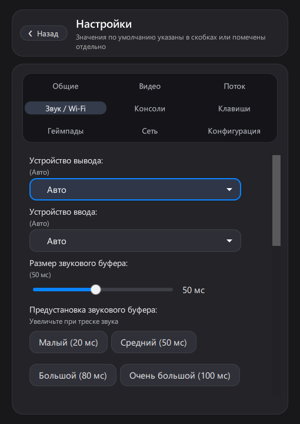</a> Compact window / Компактное окно</td>
  </tr>
  <tr>
    <td align="center"><a href="docs/ps5link/screenshots/settings.webp">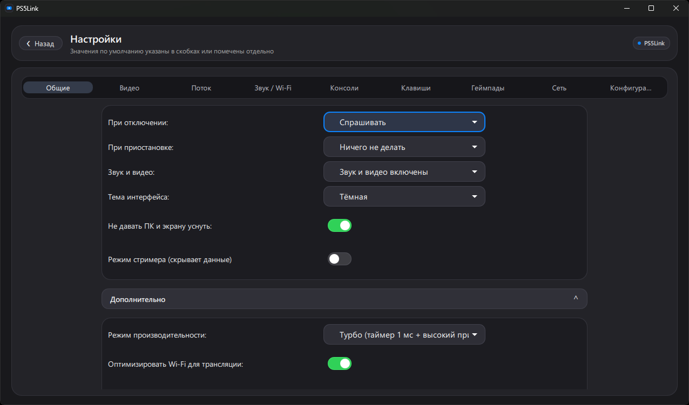</a> Advanced settings / Полные настройки</td>
    <td align="center"><a href="docs/ps5link/screenshots/installer.webp">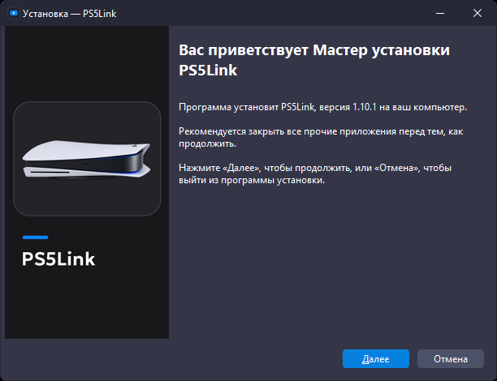</a> Windows installer / Установщик Windows</td>
  </tr>
</table>

## Project / Проект

PS5Link is an independent project based on [chiaki-ng](https://github.com/chiaki-ng/chiaki-ng).
The source is distributed under the [AGPL-3.0 with an OpenSSL exception](LICENSES/AGPL-3.0-only-OpenSSL.txt).
PlayStation is a trademark of Sony Interactive Entertainment.

PS5Link — независимый проект на базе chiaki-ng. Исходный код распространяется
под лицензией AGPL-3.0 с исключением для OpenSSL. PlayStation является
торговой маркой Sony Interactive Entertainment.
