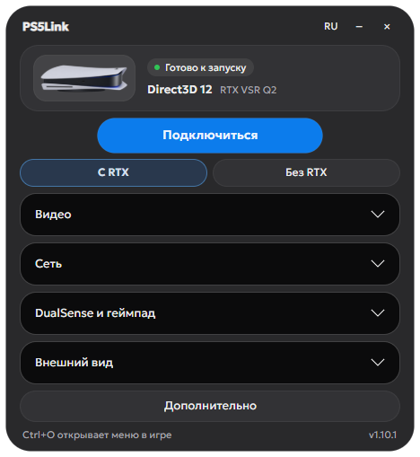

  

<h1 align="center">PS5Link</h1>

Удалённая игра на PlayStation с компьютера Windows

  <a href="README.md">English</a> ·
  <a href="https://github.com/Q1W1RTY/PS5Link/releases/latest">Скачать для Windows</a> ·
  <a href="docs/ps5link/BUILD.md">Сборка из исходников</a>

  

PS5Link передаёт изображение и звук с PS5 или PS4 на компьютер Windows.
В лаунчере на Avalonia есть кнопка **«Подключиться»**, пресеты видео и
сворачиваемые настройки видео, сети, геймпада и внешнего вида.

## Установка

1. Скачайте **PS5Link-1.10.1-win-x64-setup.exe** из раздела
   [«Релизы»](https://github.com/Q1W1RTY/PS5Link/releases/latest).
2. Запустите установщик и выберите русский или английский язык. PS5Link
   установится для текущего пользователя и появится в меню «Пуск».
   Ярлык на рабочем столе можно добавить при установке.
3. Откройте **PS5Link** из меню «Пуск».

Библиотеки приложения входят в комплект. Установщик не подписан.

## Подключение консоли

1. Включите дистанционное воспроизведение в настройках PlayStation.
2. В лаунчере откройте **«Дополнительно» → «Консоли» → «Зарегистрировать новую»**.
   Используйте код привязки с экрана консоли. Для подключения вне
   локальной сети войдите в PlayStation Network во вкладке **«Сеть»**.
3. Закройте окно настроек и нажмите **«Подключиться»**. Клиент выберет
   консоль, отмеченную для автоподключения, или единственную
   зарегистрированную консоль. Если потребуется ручной выбор, откроется
   список консолей.

Нажмите **Ctrl+O** во время трансляции, чтобы открыть игровое меню.
Кнопка **RU / EN** меняет язык лаунчера. Клиент применяет язык при
следующем запуске.

## Видео и управление

| | |
| --- | --- |
| Видео | Direct3D 12 и стандартный рендерер, аппаратное декодирование, HDR на совместимом оборудовании |
| Масштабирование | Шейдер, AMD FSR 1.0, опциональные NVIDIA RTX VSR и DLSS |
| Генерация кадров | Встроенная интерполяция, опциональные DLSS FG и AMD FSR 3.1 FG |
| Управление | Назначение клавиш, адаптивные триггеры, вибрация и подсветка DualSense |
| Сеть | Пресеты буфера пакетов и запрос ключевого кадра для восстановления видео |

В чистую сборку входят стандартный рендерер, Direct3D 12, FSR 1.0 и
встроенная интерполяция. Для RTX VSR, DLSS и FSR 3.1 FG нужны отдельные
совместимые модули. Для установленных компонентов подходит пресет
**«Без RTX»**.

## Требования и исходники

- Windows 10 версии 2004 или новее либо Windows 11, x64.
- PS5 или PS4 с включённым дистанционным воспроизведением и подключение
  к консоли по сети. Возможности видео зависят от GPU и драйвера.
- [Сборка для Windows и создание установщика](docs/ps5link/BUILD.md).

PS5Link основан на [chiaki-ng](https://github.com/chiaki-ng/chiaki-ng) и
распространяется под лицензией
[AGPL-3.0 с исключением для OpenSSL](LICENSES/AGPL-3.0-only-OpenSSL.txt).
Лицензии зависимостей включены в установщик. PlayStation является
торговой маркой Sony Interactive Entertainment. PS5Link — независимый проект.
